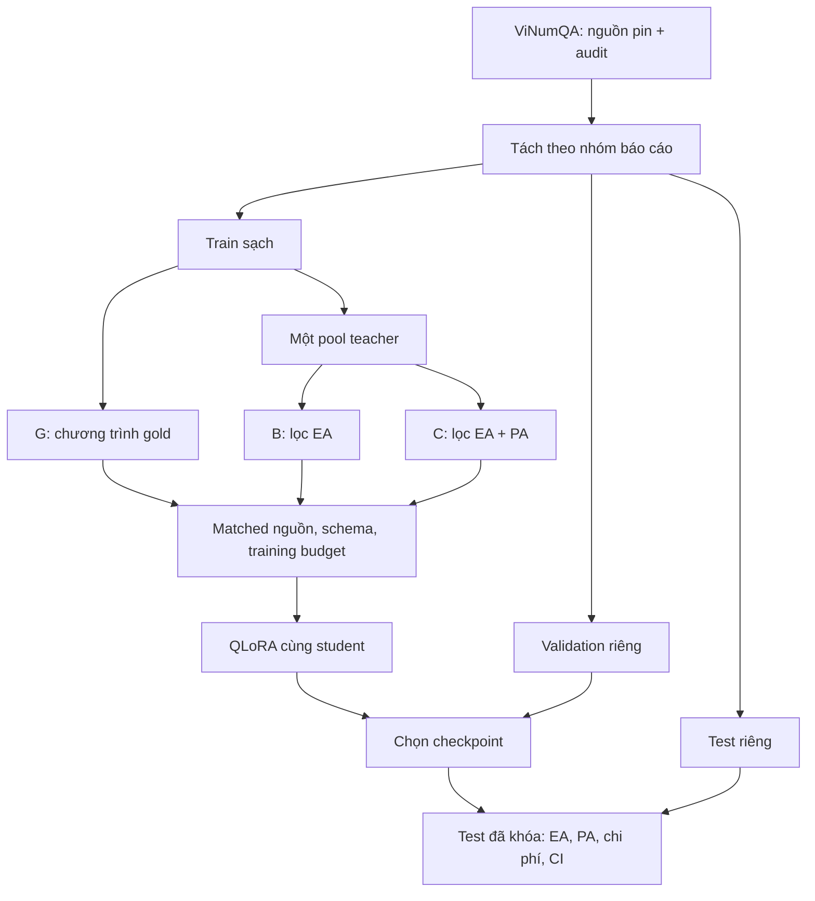

# ViNumQA Verified Distillation — Research and Implementation Plan

> **For agentic workers:** REQUIRED SUB-SKILL: Use `superpowers:executing-plans` to implement this plan task-by-task. Steps use checkbox syntax for tracking. Delegation follows the user's chosen execution method.

**Goal:** Kiểm tra liệu lọc lời giải theo chất lượng chương trình có giúp mô hình nhỏ tổng quát tốt hơn lọc chỉ theo đáp án cuối, với dữ liệu và ngân sách huấn luyện tương đương.

**Architecture:** Kế thừa ViNumQA, bộ chấm FinQA và chưng cất chương trình đã được công bố. Tạo một pool lời giải bằng một teacher; từ cùng pool xây các tập huấn luyện đối chứng, fine-tune cùng một student bằng QLoRA, rồi đánh giá trên các báo cáo nguồn được giữ riêng.

**Tech Stack:** Python 3.12; adapter dữ liệu/chấm điểm theo quy ước `code_benchmark/`; Hugging Face Transformers, PEFT và bitsandbytes trong môi trường GPU riêng trên Kaggle/Colab; `unittest` cho logic offline.

**Spec:** [Thiết kế nghiên cứu trong mục 1–8 của tài liệu này](#research-design). Các giá trị cấu hình dưới đây là đề xuất cho pilot, sẽ được đóng băng trước thí nghiệm chính.

**Ngày lập:** 30/10/2026. **Thời gian:** 4 tuần cho phần lõi, thêm 2 tuần xác nhận và hoàn thiện. **Trạng thái:** đã lập kế hoạch và khảo sát dữ liệu; chưa có pilot, lần huấn luyện hay kết quả xác nhận của nghiên cứu này.

## Global Constraints

- Dùng GPU miễn phí; ngân sách là giới hạn thiết kế, không phải cam kết quota của Kaggle/Colab.
- Câu hỏi nghiên cứu là chất lượng giám sát và khả năng chuyển giao; “train thêm rồi tăng điểm” là baseline.
- Mọi prompt, scorer, manifest và kết quả VMLU hiện có giữ nguyên phiên bản; nghiên cứu mới có `protocol_id=vinumqa-distill-v1` riêng.
- Không cài `requirements.txt` GPU snapshot của repo; không đưa Torch/Transformers vào dependency của các kiểm tra offline hiện tại.
- Không huấn luyện, sinh lời giải teacher hoặc chọn checkpoint bằng test. Chỉ audit cấu trúc, định danh, nguồn và độ dài input của test trước khi khóa điều kiện.
- Gold được cung cấp cho scorer và target huấn luyện; input inference chỉ chứa văn bản, bảng và câu hỏi.
- Không chạy lại các điều kiện đã có kết quả để tái tạo lịch sử; chỉ thực thi điều kiện mới đã đăng ký. Chưa cấp số MC trong plan này: phải kiểm tra registry lúc thực thi.
- Mỗi condition lưu hash của code, data, card, tokenizer, prompt và config; checkpoint đầy đủ cho phép resume khi GPU bị thu hồi.
- AI hỗ trợ soạn code, sinh ứng viên và gợi ý audit; nhãn do AI đề xuất không được ghi thành xác nhận của người.
- Không thay scorer/gold hoặc bỏ câu thất bại sau khi đã xem kết quả test để tăng điểm.

## Review Focus

1. **Rò rỉ nguồn:** cùng báo cáo xuất hiện trong train và test dù ID câu hỏi khác; Task 1 phải chặn theo `report_key`.
2. **Rò rỉ nhãn:** vô tình serialize toàn bộ `qa`, gold program hoặc gold retrieval vào input; Task 1/4 kiểm tra whitelist field.
3. **Sai nghĩa metric:** chương trình khác chữ nhưng tương đương, hoặc cùng đáp án nhưng khác phép tính; Task 2 kiểm tra parity với scorer upstream.
4. **So sánh không công bằng:** C học ít nguồn hơn, nhiều token hơn hoặc có output schema khác B; Task 4 khóa manifest và kiểm tra chênh lệch ngân sách.
5. **Resume/inference sai điều kiện:** mất optimizer/RNG, bật thinking mặc định hoặc bỏ câu overflow; Task 5/6 kiểm tra fingerprint, trạng thái resume và mẫu số đầy đủ.

---

<a id="research-design"></a>

## 1. Câu hỏi và giá trị của luận văn

**Tên làm việc:** *Ảnh hưởng của kiểm chứng chương trình trong chưng cất suy luận số học cho mô hình ngôn ngữ nhỏ tiếng Việt.*

- **RQ1:** Lọc theo Execution Accuracy (EA: ra đúng kết quả) và lọc thêm Program Accuracy (PA: tương đương chương trình chuẩn theo bộ chấm) tạo ra dữ liệu giám sát khác nhau đến mức nào?
- **RQ2:** Khi giữ cùng student, nguồn câu hỏi và ngân sách, phần lọc thêm có cải thiện EA trên báo cáo chưa dùng để huấn luyện không?
- **RQ3:** Lợi ích có vượt SFT trực tiếp bằng chương trình chuẩn, và có đáng với chi phí tạo/lọc dữ liệu không?

Phần lõi tận dụng PA có sẵn làm đại diện kiểm tra cấu trúc suy luận. PA không chứng minh đầy đủ rằng mô hình hiểu đúng ngữ nghĩa hoặc gắn đúng mọi số với bằng chứng. Không gọi PA là chứng minh hình thức cho toàn bộ lời giải.

Kiểm tra vị trí bằng chứng và biến đổi giá trị là nhánh mở rộng sau pilot, khi đã chỉ ra lỗi mà bộ chấm hiện có không bắt được. Không đặt việc tự xây bộ kiểm chứng mới thành điều kiện hoàn thành luận văn.

**Đóng góp dự kiến:** một so sánh có kiểm soát giữa các cách tạo giám sát, số liệu chi phí–chất lượng và phân tích lỗi tiếng Việt có thể tái lập. Khả năng phát triển bài báo phụ thuộc kết quả thực tế; chưa cam kết mức tăng điểm hoặc hạng tạp chí.



## 2. Dữ liệu thực sự dùng được

### 2.1. Nguồn chính và phiên bản

ViNumQA được mô tả trong [VLSP 2025](https://aclanthology.org/2025.vlsp-1.25.pdf), gồm câu hỏi tiếng Việt trên văn bản/bảng tài chính, `qa.program` và `qa.exe_ans`. Tệp đã đọc trực tiếp ở bản chia sẻ của nhóm triển khai, không mặc định coi đây là kênh phát hành chính thức của ban tổ chức.

Nguồn pin: [`ThanhDatVN/vinumqa-numerical-reasoning`, commit `281bdcd70abde7753d95014dbd9babec7f97f3fd`](https://github.com/ThanhDatVN/vinumqa-numerical-reasoning/tree/281bdcd70abde7753d95014dbd9babec7f97f3fd).

| Tệp | Số dòng | SHA-256 đã quan sát |
|---|---:|---|
| `data/train.json` | 2.993 | `81d44c30d47d96202810f3b4a829382ec110aae6cbd3e9366a4e46253001108e` |
| `data/valid.json` | 584 | `07eadf7d185c5d42211c624f3b32402802edf57fe5b6fe64337778a0d5524c4d` |
| `data/test.json` | 497 | `8a62a31ac8ab5276054b24fdab89262230078fe4754c817262311c5b30b623db` |

Validation/test cũng khớp byte với bản chia sẻ ở [`hoangbuituananh132109/Numerical-Reasoning-QA-for-Vietnamese-Finance`](https://github.com/hoangbuituananh132109/Numerical-Reasoning-QA-for-Vietnamese-Finance), commit `99714248ea662bcab82a2d4b9bc4ad8f1359ce1f`. Xác nhận điều khoản sử dụng dữ liệu gốc trước khi đưa lên notebook hoặc phát hành artifact; license code của mirror không tự thay thế điều khoản dataset.

### 2.2. Split nghiên cứu tách nhóm báo cáo

Audit ngày 30/10/2026 trên nguồn pin cho thấy:

- 5 mẫu validation trùng test về ID, câu hỏi, bảng, chương trình và đáp án.
- 604 dòng train có cùng nhóm báo cáo với test; 99 dòng validation có cùng nhóm báo cáo với test.
- Nhóm sơ bộ: `report_key = item_id.rsplit("/", 1)[0]`. Với nhánh FinQA, đây là nhóm công ty/năm; với nhiều báo cáo Việt Nam, đây là đường dẫn báo cáo. Phải kiểm toán ý nghĩa nhóm trước khi khóa manifest.

Quy tắc ưu tiên **test > validation > train**:

1. Giữ 497 test làm tập cuối, không dùng outcome để thiết kế.
2. Bỏ khỏi validation các dòng có `report_key` thuộc test.
3. Bỏ khỏi train các dòng có `report_key` thuộc test hoặc validation còn lại.

| Vai trò | Split gốc | Sau lọc nhóm sơ bộ | Cách dùng |
|---|---:|---:|---|
| Train | 2.993 | **2.038** | Pilot, teacher pool và SFT |
| Validation | 584 | **485** | Chọn config/checkpoint |
| Test | 497 | **497** | Đánh giá cuối |

Các số sau lọc là số dòng đã đếm, chưa phải manifest nghiên cứu đã đăng ký. Task 1 còn phải kiểm tra ID trùng trong từng split, nội dung trùng dưới ID khác, các tên nguồn tương đương và phân bố loại câu. Nếu audit làm thay đổi số mẫu, ghi lý do và khóa lại trước generation/training.

Đây là **split nghiên cứu mới**. Kết quả không được ghi như tái lập trực tiếp leaderboard dùng toàn bộ train gốc. Sự tách biệt theo nhóm quan sát được cũng không chứng minh model nền chưa gặp dữ liệu trong pretraining.

### 2.3. Nguồn bổ sung

- [FinQA chính thức](https://github.com/czyssrs/FinQA): 6.251 train, 883 dev, 1.147 public test có gold. Chỉ bổ sung ở tuần 5–6 sau audit trùng với nhánh dịch ViNumQA; không mặc định coi hai bộ độc lập.
- [TAT-QA của nhóm tác giả](https://huggingface.co/datasets/next-tat/TAT-QA): có train/dev/test-gold. Có thể dùng tập arithmetic để khảo sát chuyển giao; tiếng Anh và format thay đổi đồng thời nên phải giới hạn cách diễn giải.
- Vi-DROP hiện có dùng để phân tích lỗi/phần lịch sử. Tệp 3.309 câu hỏi local không có chương trình và đáp án; không dùng nó làm nguồn SFT có gold trong plan lõi.

## 3. Các nhóm đối chứng

| ID | Học từ gì? | Vai trò |
|---|---|---|
| P | Model gốc, prompt sinh chương trình | Mốc trước SFT; không có training run |
| G | Chương trình gold có sẵn | Đối chứng mạnh bắt buộc |
| B | Chương trình teacher qua lọc EA | Cách chưng cất cơ sở |
| C | Cùng pool teacher, qua lọc EA + PA | Phương pháp cần kiểm tra |
| G-all | Toàn bộ train sạch có gold hợp lệ | Mốc hiệu quả dùng dữ liệu; một seed, mô tả |
| A | Chỉ đáp án cuối | Tùy chọn để giải thích tác động của supervision; không cần cho kiểm định lõi |

**So sánh chính:** C với B; C với G. Nếu C hơn B mà chưa hơn G, kết luận chỉ là bộ lọc giúp so với EA-only, chưa chứng minh lợi ích vượt SFT bằng chương trình chuẩn.

G/B/C dùng cùng các ID nguồn, cùng input, cùng output schema `Program: <FinQA DSL>`, cùng student và lịch huấn luyện. Metadata bằng chứng và lời giải dài của teacher không tự động được thêm riêng vào target của C.

Nếu làm A, chấm đáp án bằng cùng quy tắc số của upstream và ghi PA là không áp dụng; A không tham gia hai kiểm định chính.

### Tạo tập matched

- Dùng một teacher và một prompt đã khóa; tối đa 3 ứng viên cho mỗi câu train được chọn. Teacher nhận context/question, không nhận gold answer/program trong prompt.
- Tái sử dụng ứng viên pilot khi và chỉ khi teacher/prompt/condition hoàn toàn giống. Khi đổi điều kiện, giữ pool và kết quả pilot riêng; không trộn response khác condition.
- Scorer dùng gold train để lọc; không gọi teacher trên validation/test để sinh target huấn luyện.
- Pool nguồn ban đầu tối đa 1.200 câu, lấy phân tầng theo nguồn Việt/dịch và số bước chương trình; chọn tất định bằng seed 42, lưu ID đầy đủ.
- B chọn một ứng viên EA-pass; C chọn một ứng viên EA+PA-pass từ cùng pool. Thứ tự chọn ngẫu nhiên tất định theo ID ứng viên, không chọn theo điểm validation.
- Chỉ lấy giao các nguồn có ứng viên cho cả B và C; G lấy chương trình gold trên đúng giao này. Mục tiêu tối thiểu 600 nguồn; báo cáo cả tỷ lệ bị loại và chênh lệch độ khó.
- Cùng số mẫu, lượt qua dữ liệu và effective batch; ghi số token thực tế. Nếu tổng token huấn luyện chênh quá 5%, cân bằng độ dài trong cùng giao nguồn trước khi khóa manifest. Không tuyên bố compute khớp tuyệt đối khi chỉ khớp số mẫu.
- G-all dùng toàn bộ train sạch có gold hợp lệ và input trong context budget, gồm cả ngoài giao; ghi rõ chi phí và khác biệt số mẫu.
- Mọi thí nghiệm tăng cường dữ liệu bằng biến thể về sau phải có đối chứng tăng dữ liệu tương đương; phần lõi chưa thêm biến thể vào training set.

## 4. Chấm điểm và cách hiểu kết quả

- Kế thừa [FinQA `code/evaluate/evaluate.py`](https://github.com/czyssrs/FinQA/blob/0f16e2867befa6840783e58be38c9efb9229d742/code/evaluate/evaluate.py), pin commit và kiểm tra tương thích ViNumQA. Chỉ viết adapter schema cần thiết; không tự đổi độ làm tròn, tolerance hoặc cách so tương đương.
- Các dependency của scorer upstream, gồm SymPy nếu cần, nằm trong môi trường thí nghiệm riêng. Module adapter import lazy; tests về dữ liệu/contract chạy stdlib-only, còn parity thật phải chạy trong môi trường đã cài dependency pin. Test bị skip không phải bằng chứng parity đạt.
- **Metric chính:** EA trên đủ các mẫu test đã khóa. **Metric phụ:** PA, tỷ lệ chương trình hợp lệ, phân tích theo nguồn/số bước và chi phí.
- Prompt cho P/G/B/C giống nhau tại inference; một lần sinh mỗi câu, cùng decoding và output cap. Không dùng gold để sửa response.
- Parse lỗi, chương trình không thực thi được, response rỗng hoặc chạm giới hạn vẫn nằm trong mẫu số. Sự cố GPU trước khi có response có thể resume bằng cùng condition; không sinh lại completed response để chọn kết quả tốt hơn.
- Bộ thực thi chỉ chấp nhận DSL upstream; không `eval`/`exec` mã do model sinh. Kết quả thuộc hệ thống student + bộ thực thi, không gọi là khả năng tính toán nội tại của model.
- Gold nghi vấn: lưu audit riêng; primary score vẫn theo gold đã khóa. Không tự sửa test sau khi xem output.

### Thống kê được khóa trước test

- Seed huấn luyện **42** là phân tích chính đã chỉ định trước. Seed 43/44 là các lần xác nhận cho G/B/C; không chọn seed tốt nhất.
- Báo cáo chênh EA theo điểm phần trăm; CI95 bằng paired cluster bootstrap theo `report_key` của test, 10.000 resample, seed 7.
- Hai kiểm định C–B và C–G: hoán đổi dấu chênh lệch ở mức nhóm báo cáo, 20.000 mẫu, hai phía; Holm trên đúng hai p-value này. Lưu giả định của phép thử và code tính toán trong registration.
- Các seed xác nhận báo cáo riêng và trung bình/độ phân tán; không cộng chúng thành 1.491 câu độc lập. Kết quả chỉ ổn định khi chiều tác động được lặp lại; ba seed vẫn hạn chế việc suy rộng về nhiễu huấn luyện.
- Mốc thực dụng đề xuất: tăng ít nhất **3 điểm EA**. Bằng chứng mạnh cho tuyên bố “vượt hai baseline” đòi hỏi cả hai đối chiếu đạt mốc này, Holm p < 0,05 và cận dưới CI95 > 0. Kết quả khác phải mô tả đúng từng đối chiếu.
- 497 câu/nhóm báo cáo có thể thiếu lực để xác nhận chênh nhỏ; dùng discordance pilot để ước lượng độ nhạy trước test. Không hứa xác nhận được 1–2 điểm, không kéo dài chạy test đến khi có ý nghĩa.

## 5. Student và ngân sách miễn phí

Student khởi đầu: [`Qwen/Qwen3-1.7B`](https://huggingface.co/Qwen/Qwen3-1.7B), pin revision/tokenizer khi bắt đầu. Đây là backbone huấn luyện mới, không phải checkpoint Qwen API/GGUF đang được dùng trong các phép đo cũ.

| Tham số pilot | Đề xuất |
|---|---|
| Chế độ | Non-thinking, `enable_thinking=False` ở train và inference |
| PEFT | QLoRA 4-bit NF4; LoRA rank 16, alpha 32, dropout 0,05; `target_modules="all-linear"` |
| Training | 2 epoch; learning rate `2e-4`; warmup 3%; micro-batch 1; accumulation 8; gradient checkpointing bật |
| Context | Khởi đầu 4.096 token, loss chỉ trên phần assistant; không cắt context âm thầm |
| Precision | BF16 nếu GPU hỗ trợ; nếu không FP16; ghi hardware/dtype thật |
| Inference | Non-thinking, greedy, tối đa 256 token mới; cùng cấu hình cho P/G/B/C |
| Checkpoint | Mỗi 50 optimizer step và cuối epoch; gồm adapter, optimizer, scheduler, RNG và vị trí dữ liệu |

Các giá trị là điểm xuất phát để đo fit/throughput, không phải cấu hình đã tối ưu. Context cap cuối cùng chọn từ audit input và pilot GPU trước thí nghiệm chính. Câu test vượt cap bị ghi failure trong denominator; không loại nó khỏi báo cáo. Chọn checkpoint bằng EA validation ở cùng các mốc nửa epoch; hòa điểm lấy checkpoint sớm hơn.

**Trần thiết kế:** 30 GPU-giờ, gồm tối đa 4 giờ pilot, 18 giờ training, 8 giờ inference. Đây là mức cắt phạm vi tự đặt, chưa phải số giờ đã đo hay quota được bảo đảm.

- Thứ tự ưu tiên: G/B/C seed 42 → G-all seed 42 → G/B/C seed 43/44 → model thứ hai/nguồn bổ sung.
- Sau 20 optimizer step pilot, đo peak VRAM và giây/step; tính ngân sách cho toàn bộ lịch, gồm evaluation/checkpoint. Ghi dự toán và số thực tế.
- Nếu vượt trần: bỏ phần mở rộng trước; thu nhỏ số nguồn matched đồng thời ở G/B/C trước khi khóa protocol. Nếu chỉ đủ một seed, báo cáo exploratory, không giấu việc thiếu xác nhận.
- Bắt đầu pilot trên GPU được cấp thực tế; không ghi tên GPU/quota cố định trước khi kiểm tra. Không chạy hai notebook tranh cùng GPU.
- Generation teacher chạy qua route sẵn có, không chiếm GPU student. Pilot tối đa 300 request/2 triệu reported token; full generation thêm tối đa 3.600 request/16 triệu token. Đây là trần vận hành, phải kiểm tra quyền dùng/chi phí route trước khi gửi.
- Chốt một teacher ID/route ở Task 3 từ endpoint hiện có, kiểm tra điều khoản cho phép tạo dữ liệu huấn luyện và lưu model ID từng response. Hết ngân sách hoặc đổi model thì dừng condition, không âm thầm đổi teacher.
- Dependency GPU được khóa sau lần smoke test thành công. Dùng môi trường riêng; resume phải khôi phục cả optimizer/RNG, không chỉ nạp adapter cho inference.

## 6. Pilot và mốc quyết định sau 7 ngày

Pilot dùng **100 nguồn từ train sạch**, chưa mở test outcome. Các nguồn này vẫn là dữ liệu phát triển, không phải một bài đánh giá xác nhận.

| Điều cần biết | Bằng chứng cần có | Hành động |
|---|---|---|
| Dữ liệu/scorer dùng được | Manifest không chồng nguồn; schema và scorer parity đạt; train gold không thực thi được được liệt kê | Chưa đạt thì sửa adapter/audit, chưa training chính |
| EA-only có bỏ lọt lỗi đáng kể? | Ít nhất 10% ứng viên EA-pass bị PA loại; xác nhận bằng audit, không chỉ đếm parser lỗi | Nếu ít hơn, không mặc định có đủ khác biệt để train thêm C |
| Bộ lọc đáng tin trong mẫu audit? | Audit tối đa 30 EA-pass/PA-fail và 30 PA-pass; không quá 1 false rejection trong 30 mẫu kiểm tra, hoặc audit toàn bộ nếu ít hơn | Không đạt thì sửa mapping/scorer trên train rồi pilot lại một lần |
| C có đủ độ phủ? | Ít nhất 70/100 nguồn có cả ứng viên B và C; target B/C thực sự khác ở ít nhất 10% nguồn | Nếu thấp, tránh kết luận từ một giao nguồn quá hẹp |
| GPU đủ cho kế hoạch? | 20 optimizer step và một lượt save/resume thành công; dự toán nằm trong 30 giờ | Thu nhỏ phạm vi đồng đều trước registration nếu cần |

Ngưỡng trên là quy tắc vận hành pilot, không phải bảo đảm thống kê về toàn bộ dữ liệu. Audit có người kiểm tra và ghi rationale; AI chỉ gợi ý. Nếu chỉ có một người audit thì ghi rõ, không báo inter-annotator agreement. Nếu có người thứ hai, giữ đánh giá độc lập trước khi đối chiếu.

**Quyết định ngày 7:**

- **Tiếp tục:** pipeline đúng, có khác biệt giám sát thực chất, độ phủ và tài nguyên đủ. Khóa protocol rồi chạy phần lõi.
- **Thu hẹp:** C gần như trùng B; chuyển trọng tâm sang tái lập chưng cất so với G và phân tích chi phí. Đổi tên/câu hỏi nghiên cứu trước test, không tiếp tục quảng bá bộ lọc mới.
- **Dừng hướng cải tiến này:** sau tối đa một vòng sửa pilot vẫn chưa có contrast đáng kiểm chứng hoặc scorer không đáng tin. Tổng hợp bằng chứng đã có, quyết định lại hướng nghiên cứu; không tiêu hết 6 tuần để buộc ra kết quả dương.

## 7. Lịch 4–6 tuần và vai trò của AI

| Tuần | Công việc chính | Sản phẩm kiểm chứng được |
|---|---|---|
| 1 | Đọc phương pháp gần nhất; audit split/scorer; 100 nguồn pilot; smoke test GPU | `data_audit.json`, `scorer_parity.json`, `pilot_report.md`, quyết định ngày 7 |
| 2 | Khóa protocol/card; tạo pool teacher; xây G/B/C matched; audit | Registration, ledger ứng viên, manifest/target JSONL, resource estimate |
| 3 | Training G/B/C seed 42, G-all; khôi phục checkpoint; chọn bằng validation | Adapter/config/log/checkpoint, lựa chọn được ghi trước test |
| 4 | Hoàn thành các seed xác nhận trong trần; chạy test của toàn bộ condition đã khóa; phân tích | Raw predictions, score từng câu, CI/kiểm định, bản nháp chương thực nghiệm |
| 5 | Nếu còn quota: kiểm tra bằng chứng/biến đổi khi PA có lỗ hổng đã quan sát, model nhỏ thứ hai hoặc dataset chuyển giao; chọn tối đa một nhánh | Khảo sát giới hạn/phạm vi áp dụng, không tạo thêm ba dự án |
| 6 | Hoàn thiện hình/bảng, chương phương pháp, related work, giới hạn và gói tái lập | Luận văn hoàn chỉnh + bản thảo bài báo theo kết quả thực tế |

**Nếu deadline là 4 tuần:** dừng ở phần lõi; ưu tiên hoàn thiện luận văn và các lần xác nhận hơn mở model/dataset mới. Viết related work, phương pháp và bảng nguồn dữ liệu song song từ tuần 1.

Nhánh được thiết kế sau khi đã xem test chính chỉ được ghi là exploratory trên các câu đã xem. Muốn có kết luận xác nhận mới phải khóa một tập đánh giá độc lập trước khi thực thi nhánh đó.

AI chịu phần scaffold, unit test có ý nghĩa, chuyển đổi schema, sinh ứng viên, phân loại lỗi sơ bộ, vẽ bảng/hình và soạn bản nháp. Người nghiên cứu chịu trách nhiệm chọn giả thuyết, xác nhận audit, khóa protocol và phê duyệt cách diễn giải. Tốc độ sinh thêm code/dữ liệu không thay thế việc kiểm chứng đúng câu hỏi nghiên cứu.

## 8. Điều kiện hoàn thành và cách diễn giải

- Có nguồn pin, manifest, split theo nhóm và audit chất lượng nhãn.
- Có P/G/B/C; G-all theo ngân sách đã đăng ký; các condition chính dùng cùng nguồn và schema.
- Có ít nhất một bộ dự đoán đầy đủ và phân tích đúng mẫu số; mức độ xác nhận seed được ghi rõ.
- Có bảng EA/PA/validity, chi phí generation/training/inference và các ví dụ sửa được/làm hỏng có nguồn.
- Có kết luận theo từng đối chiếu: C hơn cả B/G; chỉ hơn B; hoặc chưa có bằng chứng hơn. “Chưa có bằng chứng” không đồng nghĩa đã chứng minh tương đương.
- Có các giới hạn về source split, gold, pretraining exposure, student nhỏ, GPU budget và PA như một proxy.
- Có lệnh tái lập và artifact đủ để người khác chấm lại; không cần dựng dashboard mới để hoàn thành nghiên cứu.

## 9. Bản đồ file và artifact khi thực thi

Đây là file dự kiến, chưa được tạo bởi việc lập plan này. Dữ liệu raw, candidate replies, weights và checkpoint ở vùng artifact không commit; kiểm tra `.gitignore` trước khi tải dữ liệu.

| Vị trí | Trách nhiệm |
|---|---|
| `data/vinumqa_distill_v1/{sources,splits,protocol,prompts,training,registration}.json` | Các cấu hình/manifest nhỏ, versioned và hash được |
| `docs/measurement_cards/<allocated-card>-vinumqa-distillation.md` | Điều kiện đo mới; registry cấp lúc thực thi |
| `code_benchmark/vinumqa_data.py` | Read/schema whitelist, report grouping, source-disjoint split và audit |
| `code_benchmark/vinumqa_scoring.py` | Adapter scorer upstream đã pin, không đổi metric |
| `code_benchmark/vinumqa_distill.py` | Lọc EA/PA, chọn candidate, xây matched exports |
| `code_benchmark/analyze_vinumqa_distill.py` | Join predictions/manifest, EA/PA, cluster CI và kiểm định đã đăng ký |
| `code_benchmark/test_vinumqa_distill.py` | Unit/parity/contract tests offline |
| `experiments/vinumqa_distillation/{train,predict}.py` | Entry point GPU cho condition mới, tái sử dụng module dữ liệu/scorer |
| `experiments/vinumqa_distillation/requirements.lock.txt` | Bộ dependency GPU thực sự đã smoke test |
| `notebooks/vinumqa_distillation.ipynb` | Launcher Kaggle/Colab mỏng; không nhân bản logic |
| `all_res/vinumqa_distill_v1/` | Raw data pin, candidates, audit, run ledger, adapters, predictions và analyses |
| `docs/research/vinumqa-distillation-results.md` | Báo cáo kết quả có nguồn sau khi chạy |

Interfaces lõi, dùng thống nhất giữa các task:

```text
read_items(path: Path, split: str) -> list[dict]
report_key(item_id: str) -> str
build_source_disjoint_splits(splits: dict[str, list[dict]]) -> dict
render_input(item: dict) -> str
score_program(program: str, item: dict) -> dict  # valid, ea, pa, error_code, scorer_hash
filter_candidates(candidates: list[dict], mode: str) -> list[dict]  # ea | ea_pa
build_matched_exports(items: list[dict], candidates: list[dict], config: dict) -> dict
analyze_runs(predictions: list[dict], manifest: dict, config: dict) -> dict
```

Các hàm không in raw gold vào log inference; lỗi schema/hash phải fail fast. `score_program` chỉ dùng DSL, không nhận Python tùy ý.

## 10. Tasks thực thi có đầu ra kiểm tra được

### Task 1 — Audit và đóng băng dữ liệu

**Files:** `vinumqa_data.py`, `test_vinumqa_distill.py`, `sources.json`, `splits.json`; raw/audit trong `all_res/`.

**Consumes:** nguồn pin và SHA-256 ở mục 2. **Produces:** `read_items`, `report_key`, `build_source_disjoint_splits`, `render_input` và manifest có ID/hash.

- [ ] Viết các test `test_source_hash_mismatch_fails`, `test_same_report_different_question_is_excluded`, `test_test_precedes_valid_precedes_train`, `test_duplicate_identity_fails`.
- [ ] Chạy test và xác nhận lỗi đúng vì interface chưa được triển khai.
- [ ] Triển khai adapter; whitelist input chỉ `pre_text`, `table`, `post_text`, `qa.question`; thêm `test_render_input_never_contains_gold_fields` bằng gold marker duy nhất.
- [ ] Chạy audit thực tế, đối chiếu các số dòng sơ bộ 2.038/485/497; giải thích mọi chênh lệch và kiểm tra source grouping bằng tay trên các kiểu ID.
- [ ] Xác nhận quyền sử dụng, lưu hash manifest và test outcome boundary; commit riêng code/manifest hợp lệ, không commit raw data.

### Task 2 — Scorer parity và ví dụ cùng đáp án, khác chương trình

**Files:** `vinumqa_scoring.py`, `test_vinumqa_distill.py`; upstream code theo license/hash riêng.

**Consumes:** item schema của Task 1, scorer upstream pin. **Produces:** `score_program` với EA/PA giữ nguyên nghĩa.

- [ ] Viết test cho chương trình gold, biểu thức tương đương khác thứ tự hợp lệ, chương trình sai nhưng cùng đáp án, giá trị âm/phần trăm, parse lỗi, chia 0 và chuỗi ngoài DSL.
- [ ] Xác nhận test fail đúng; triển khai adapter nhỏ nhất để chạy upstream scorer, không viết lại phép so số để làm điểm cao hơn.
- [ ] Replay trên gold train/validation: liệt kê gold invalid và các schema chưa hỗ trợ; không sửa nhãn âm thầm. Chưa chạy model hay kiểm tra gold test trong bước parity phát triển.
- [ ] Chỉ pass khi adapter và upstream khớp từng fixture; lưu hash, dependency và báo cáo parity; commit tập trung.

### Task 3 — Teacher pilot và quyết định ngày 7

**Files:** cấu hình pilot/prompts trong `data/vinumqa_distill_v1/`; candidate/audit ledger và `pilot_report.md` trong `all_res/`.

**Consumes:** train sạch + `score_program`. **Produces:** pool ứng viên có `source_id`, `candidate_id`, model/route, raw response, usage, EA/PA và rationale audit.

- [ ] Chọn 100 train source tất định theo phân tầng; khóa teacher ID/route, prompt và điều kiện sử dụng dữ liệu; probe không dùng benchmark item trước launch.
- [ ] Tận dụng transport/ledger hiện có để sinh tối đa 3 ứng viên/source, 4 request đồng thời; halt khi auth/model drift hoặc hết ngân sách. Completed response là terminal, resume chỉ phần chưa có response.
- [ ] Audit các nhóm ở mục 6; ghi riêng AI suggestion và human judgment, không mở test outcome.
- [ ] Chạy smoke test GPU bằng một launcher pilot dựa trên ví dụ PEFT upstream, chưa phụ thuộc entry point của Task 5: 20 optimizer step cùng save/resume; đo throughput/VRAM, dự toán lịch đầy đủ. Lưu launcher/config để Task 5 kế thừa.
- [ ] Ghi quyết định tiếp tục/thu hẹp/dừng và scope cuối. Chỉ sang Task 4 nếu điều kiện pilot đạt hoặc đã sửa câu hỏi nghiên cứu minh bạch.

### Task 4 — Registration, matched targets và environment

**Files:** `vinumqa_distill.py`, `test_vinumqa_distill.py`, protocol/prompts/training/registration JSON, card mới; GPU lockfile.

**Consumes:** Task 1–3 đã pass. **Produces:** `filter_candidates`, `build_matched_exports`, train JSONL G/B/C và condition fingerprints.

- [ ] Viết test `test_ea_and_ea_pa_filters_differ_on_spurious_solution`, `test_matched_source_ids_identical`, `test_target_schema_identical`, `test_selection_is_deterministic`, `test_training_token_budget_mismatch_fails`.
- [ ] Xác nhận fail; triển khai selection/export theo mục 3. Test manifest train không nhận ID/report thuộc validation/test.
- [ ] Tạo full teacher pool trong budget, audit mẫu; khóa giao nguồn, số sample, độ dài target và tỷ lệ target B/C khác nhau. Không bỏ bước G vì teacher đã có đáp án đúng.
- [ ] Chốt context/optimizer/teacher/sampling config và package lock từ smoke test. Kiểm tra registry mới nhất rồi thêm measurement card, không đoán số MC.
- [ ] Đăng ký hai đối chiếu chính, seed, metric, bootstrap/test và checkpoint rule; commit source/registration trước training chính.

### Task 5 — QLoRA và checkpoint có thể tiếp tục

**Files:** `experiments/vinumqa_distillation/train.py`, notebook launcher; artifact GPU.

**Consumes:** matched exports, frozen training config. **Produces:** adapter và full Trainer checkpoint theo `(arm, seed, condition_hash)`.

- [ ] Viết test offline cho config/hash và loss mask; chỉ phần assistant là target, base weights không được train. Chạy test fail trước khi triển khai logic tương ứng.
- [ ] Dùng PEFT/Transformers theo tài liệu chính thức; môi trường GPU riêng. Notebook gọi entry point, không chứa một bản logic khác.
- [ ] Integration check trên GPU: lưu ở step 20, resume, xác nhận optimizer step/scheduler/RNG/trạng thái dữ liệu và adapter trainable được khôi phục. Lưu bằng chứng; không coi chỉ load adapter là resume đầy đủ.
- [ ] Chạy G/B/C seed 42 trước; chọn checkpoint theo validation đã đăng ký. Chạy G-all và seed 43/44 theo resource gate; ghi cả run lỗi và giờ đã dùng.
- [ ] Khi phải đổi config vì OOM, tạo condition mới cho cả nhóm so sánh; không ghép hai nửa config thành một run. Commit launcher/config, không commit weights.

### Task 6 — Inference và phân tích cuối

**Files:** `experiments/vinumqa_distillation/predict.py`, `code_benchmark/analyze_vinumqa_distill.py`, `code_benchmark/test_vinumqa_distill.py`; predictions/report trong `all_res/`.

**Consumes:** checkpoint đã chọn bằng validation, manifest/card đã khóa. **Produces:** một prediction/source/condition và bảng phân tích ở mục 4.

- [ ] Viết test `test_denominator_keeps_invalid_and_overflow`, `test_completed_prediction_is_not_retried`, `test_missing_id_fails`, `test_paired_report_resampling`, `test_primary_seed_cannot_be_selected_by_test_score`.
- [ ] Xác nhận fail; triển khai inference export và analysis. Fixture phải bắt trường hợp nhiều câu cùng report để không tính CI như các mẫu độc lập.
- [ ] Mở test outcome bằng các condition đã khóa, chạy đủ denominator. Không sửa parser/gold khi thấy case bị mất điểm; lưu vấn đề để mô tả hoặc nghiên cứu sau.
- [ ] Chấm EA/PA với scorer hash, xuất chênh điểm, CI và Holm cho đúng hai đối chiếu; báo cáo từng seed, không lấy best-of.
- [ ] Kiểm tra operator breakdown, native/translated, các trường hợp C cứu/làm hỏng so với G/B; mọi ví dụ phải có item ID và raw response đối chiếu được.

### Task 7 — Luận văn và gói tái lập

**Files:** báo cáo kết quả mới, chương luận văn được người dùng chỉ định lúc viết, artifact manifest.

**Consumes:** data/condition/prediction/analysis hashes. **Produces:** các bảng/hình, luận văn và bản thảo phản ánh đúng kết quả.

- [ ] Viết related work và phương pháp từ tuần 1; trích dẫn rõ phần kế thừa và phần thực nghiệm của nhóm.
- [ ] Hoàn thiện bảng điểm, scatter chi phí–EA, phân bố khác biệt EA/PA trong teacher pool và các ví dụ có nguồn. Dùng matplotlib cho hình xuất bản.
- [ ] Đối chiếu mọi con số với artifact; ghi số seed/quota thực tế, nhãn nghi vấn, các run bị dừng và giới hạn suy rộng.
- [ ] Tạo hướng dẫn chấm lại từ predictions và hướng dẫn train từ nguồn pin; kiểm tra một đường tái lập offline. Không yêu cầu chạy lại toàn bộ GPU để xác nhận bảng đã có.
- [ ] Chỉ chọn venue/bài báo sau khi thấy kết quả; kết quả âm hoặc chưa đủ lực thống kê vẫn được báo cáo đúng.

## 11. Kiểm tra trong quá trình triển khai

Khi đã tạo các module tương ứng, chạy từ root:

```bash
.venv/bin/python -m unittest code_benchmark.test_vinumqa_distill
uvx ruff@0.16.1 check code_benchmark
uvx --from bandit bandit -r code_benchmark -c .bandit.yml -q
.venv/bin/python code_benchmark/test_parsing.py
.venv/bin/python -m unittest code_benchmark.test_suite
```

Đây là lệnh dự kiến cho giai đoạn thực thi, chưa phải các kiểm tra đã chạy của nghiên cứu này. Unit tests không thay thế smoke test GPU hoặc audit nhãn. Khi chỉ sửa tài liệu, kiểm tra link, cấu trúc Markdown, tính nhất quán số liệu và `git diff --check` là đủ.

## 12. Tài liệu tham khảo và điểm kế thừa

1. [ViNumQA / VLSP 2025](https://aclanthology.org/2025.vlsp-1.25.pdf): dataset, split gốc, schema và task.
2. [FinQA code/data](https://github.com/czyssrs/FinQA): DSL, EA/PA và quy trình chấm; pin commit nêu ở mục 4.
3. [Program-Centric Policy Optimization cho QA tài chính tiếng Việt](https://aclanthology.org/2025.vlsp-1.26.pdf): structured supervision và distillation; phần RL không thuộc lõi của plan này.
4. [Gold-Guided Programmatic Distillation](https://arxiv.org/abs/2607.14709): nền tảng lọc lời giải thực thi được để dạy student. Không coi program distillation là phát minh mới của nhóm.
5. [PEFT quantization](https://huggingface.co/docs/peft/developer_guides/quantization): QLoRA, `prepare_model_for_kbit_training` và all-linear adapters.
6. [Qwen3-1.7B model card](https://huggingface.co/Qwen/Qwen3-1.7B): backbone, template và non-thinking mode; pin revision lúc thực thi.
7. [`openspec/specs/eval-scoring/spec.md`](../../../openspec/specs/eval-scoring/spec.md), [`measurement_card.md`](../../../measurement_card.md), [`AGENTS.md`](../../../AGENTS.md): ranh giới scoring, đăng ký điều kiện và quy ước repo.

## 13. Trạng thái bàn giao

- [x] Chốt câu hỏi có thể bác bỏ và đối chứng G/B/C.
- [x] Đọc được nguồn dataset pin và phát hiện vấn đề trùng nhóm nguồn.
- [x] Lập split nghiên cứu sơ bộ, resource gate, pilot gate và lịch 4–6 tuần.
- [x] Ghi các task, interface, kiểm tra và cách diễn giải kết quả.
- [ ] Thực thi Task 1–7; chưa có kết quả nghiên cứu mới để báo cáo.
